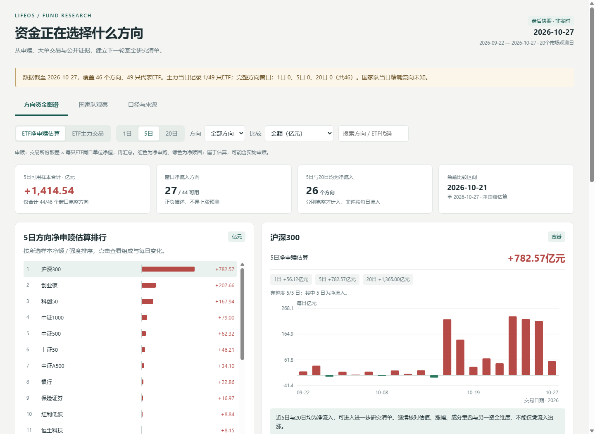
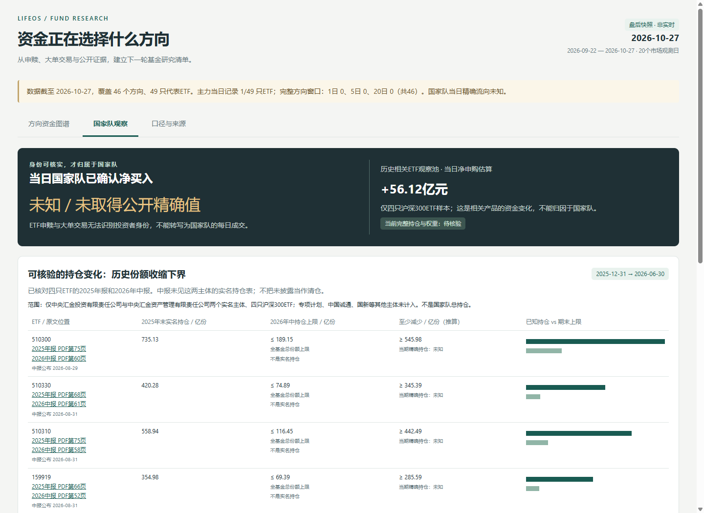

# 基金投资与管理技能

帮助用户形成“目标与资金安排 → 配置与候选比较 → 投入/调整方案 → 本地记录 → 持续复盘”的工作流程。提供公开数据采集、来源核验、组合核对及离线报告，操作判断由具体研究提供，不由分数自动生成交易。

首次使用、基金/A/C比较、定投、持仓调整与定期管理的流程见[投资与持续管理](references/investment-management.md)。用户只问单只产品或费用时直接研究，不强制完整个人问卷。

## 默认能力

- 采集公开费率、资产配置及管理人定期报告，保留原文、日期和失败状态。
- 从完整报告核对总资产/净资产、实际股票和转债配置、符合条件的完整权益集中度。
- 接入已有产品缓存的阶段业绩与现任团队任期。
- 默认`public-core-v2.0`，输出有限维度的基础参考分及基础证据覆盖。支持六类产品，规则为启发式，未经收益预测验证。
- 完整操作分析生成一个独立HTML；单独评分入口生成HTML及可复算JSON。
- 本地持仓列表支持备份、原子写入和并发冲突检查；文件损坏不当成空持仓覆盖。
- 按同日同币种已知市值与已声明分组核对配置；目标未确认或分母不完整时不生成配置金额。
- 观察46个方向、49只代表ETF的申赎估算、ETF大单交易及国家队公开证据，生成可交互的单文件资金看板；数据缺失保留未知。

## 资金方向看板

把资金面作为“下一步研究哪些基金”的辅助，不直接生成买卖评级。支持1/5/20日切换、金额/期初规模强度比较、方向分类、代码搜索、每日趋势、持续性热图、ETF样本组成及原文审计。无需前端构建或外部图表CDN，报告可直接在本地打开。

### 效果图

以下为截至 **2026-10-27** 的公开数据实采效果；截图保留覆盖率和缺口提示，不含个人持仓或账户信息。

方向排行与每日趋势：



国家队历史持仓与证据：



### 国家队和主力数据是否能获取？

**能获取一部分，但属于不同口径。** 不应把“本轮接口失败”说成“主力数据不存在”，也不能把ETF资金变化直接归因于国家队。

| 数据层 | 实现与来源 | 本次实际覆盖及限制 |
| --- | --- | --- |
| ETF净申赎估算 | 沪深交易所份额差 × 每只ETF同日单位净值，再汇总方向 | 44/46个方向具备完整1/5/20日窗口；纳指、标普500样本因同日净值滞后保留缺失。属于代表样本，非全市场行业统计 |
| ETF主力交易 | 东方财富按订单大小统计的大单/超大单净额；历史路由失败时尝试当日快照路由 | 历史接口返回空响应；备用路由单次验证能返回当日6列记录，但另一只ETF验证仍断开。当前仅有1/49只ETF有效记录，暂无完整方向排行；不宣称批量已修复 |
| 国家队实名持仓 | 基金原始年报中的实名持有人、相关公告 | 已核验四只沪深300ETF的2025年报和2026中报，共8份原文。2025年末实名份额可查；所查2026中报未见对应实名份额表，不能因未披露判为清仓 |
| 国家队历史数量变化 | 在确认期间没有份额拆分后，以全基金总份额作为两实名主体期末持仓上界，推算减少的保守下界 | 仅针对四只产品、两个主体、2025年末至2026年中；是“亿份”数量推算，不是资金流出金额，也不是当前国家队整体持仓 |
| 国家队每日精确买卖 | 当前未取得可核验的公开逐日明细 | 保留未知。相关ETF申赎、放量或大单交易都不能证明买方/卖方身份 |

覆盖数字是本次快照的验收状态，不是永久可用性承诺。年报/中报证据目前是已核验静态资料集，尚未自动刷新全部国家队持仓；后续报告应重新核日期和范围。资金面不并入`public-core-v2.0`基础分。

### 参考实现及采用范围

| 参考项目 | 可以参考什么 | 本项目如何处理 |
| --- | --- | --- |
| [digger-yu/etf](https://github.com/digger-yu/etf) · [采集源码](https://github.com/digger-yu/etf/blob/main/scripts/fetch_data.py) | 通过AkShare采集沪深交易所ETF份额、失败时备选实时ETF数据；按方向聚合、热图与排行；提供GitHub Actions工作流 | 参考采集渠道和交互。其采集文件没有国家队账户识别或真实机构逐日买卖字段。我们的申赎按逐基金净值计算，不使用“汇总份额×代表ETF净值”作为板块资金金额；未启用自动任务 |
| [AKShare](https://github.com/akfamily/akshare) · [资金流源码](https://github.com/akfamily/akshare/blob/main/akshare/stock/flow/stock_fund_em.py) | 东方财富历史资金流请求参数、字段和单位 | 参考历史路由契约，独立实现标准库采集；AkShare使用相同上游，换成该库不等于有独立数据源 |
| [东方财富接口记录](https://github.com/wlor0623/llm-dev-knowledge/blob/main/knowledge-base/eastmoney-quotes-api/endpoints/capital-flow.md) | `fflow/kline/get`备用公开路由 | 已实际验证一次返回当日快照并接入降级。以真实响应识别日期和6列/15列结构，不把单条快照补成历史数据；来源仍可能拒绝连接 |

独立编写采集和呈现，不复用参考项目的旧数据或其白银LOF估算份额。更多字段、计算、证据与运行边界见[资金方向观察](references/fund-capital-flows.md)。

### 生成看板

资金看板采集与生成仅依赖Python标准库。以下命令在仓库根目录运行，示例路径不含个人数据：

```bash
python scripts/capital_flow_data.py --as-of 2026-10-27 --cache-dir data/Private/capital_flows/raw --output data/Private/capital_flows/snapshot.json
python scripts/capital_flow_report.py --input data/Private/capital_flows/snapshot.json --output data/Private/capital_flows/report.html
python -m unittest tests.test_capital_flow -v
```

把`--as-of`改成实际研究截止日。重用原文、不联网重建时，第一步添加`--offline`。脚本不会自动开启采集计划、交易或上传本地报告。相同主机访问失败后本轮暂停，保留错误；备用快照不伪装为多日历史。精确代码去重、同日净值及完整窗口检查用于避免重复计数、错日计算与缺失补零。

## 字段和评分范围

| 类型 | 默认基础维度 |
| --- | --- |
| 债券 | 一年回撤、名义费用、披露杠杆、转债比例 |
| 增强债/偏债配置 | 一年回撤、费用、杠杆、股票/转债比例 |
| 主动权益 | 一年回撤、费用、完整股票集中度、现任团队连续性 |
| 指数/联接 | 一年回撤、费用；不评价跟踪质量与估值 |
| 货币 | 费用、注明渠道的常规到账；不评价信用安全 |

信用细分、组合久期、三年合同基准超额、真实日频跟踪误差和长期估值百分位不再是默认必填评分。它们有条件获取，但不能保证每只基金都有免费、同口径数据。证据有效时作为扩展研究展示，不显示一排没有数据的必填项，也不影响基础覆盖率。渠道及当前接入状态见[数据源说明](references/fund-data-sources.md)。

基础维度100%仅代表本模型资料齐全，不能称为基金综合评级或完整风险覆盖。新版缩小了评分范围，不能将其覆盖率与旧模型直接比较。历史`research-v1.0`仍可显式复算。

## 使用

```bash
pip install -r requirements.txt
python scripts/public_data_sources.py --codes <六位代码> --as-of <YYYY-MM-DD> --cache-dir <本地缓存>
python scripts/operation_report.py --input <本地研究JSON> --supplemental-data-dir <本地缓存> --output <本地报告.html>
python scripts/research_report.py --input <本地证据JSON> --supplemental-data-dir <本地缓存> --output-dir <本地输出目录>
python scripts/portfolio_diagnostics.py --input <本地管理JSON> --output <本地核对.json>
python -m pytest tests -q
```

可选采集代理用`--proxy`指定，显式刷新用`--refresh`。离线报告不联网；公开报告采集需要`pypdf`，原V1/V2功能另使用原依赖。实际持仓、报告、缓存只在本地私密/忽略目录保存，外部接口只接收公开基金代码。

本地列表不等于申赎流水账，不自动计算个人XIRR、重建成本或执行买卖。复盘频率、目标比例和定投预算由用户确认；不承诺收益、回本时间或最大回撤。支持范围与实际自动化能力以流程及数据源说明为准。

输入字段、版本选择和权重见[评分契约](references/research-scoring.md)，完整研究判断见[操作报告契约](references/operation-report.md)。技能入口见[SKILL.md](SKILL.md)。

[历史V1/V2接口和示例](references/legacy-usage.md)保留供兼容查阅；其中旧版自动操作、舆情或推荐器的描述不代表默认基础入口具备相同能力。旧算法边界见[计算边界](references/analysis-boundaries.md)。
